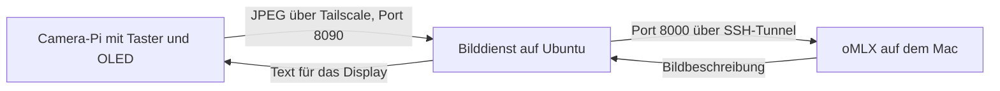

# Camera-Pi

Ein Knopfdruck nimmt ein Foto auf. Wenig später erscheint eine kurze Beschreibung auf dem OLED-Display des Raspberry Pi.

Auf dem Pi laufen Kamera, Taster und Anzeige. Ein Python-Dienst auf Ubuntu nimmt das Bild entgegen und reicht es an oMLX auf einem Mac weiter. Das Modell erhält die Aufgabe, das Bild auf Deutsch in höchstens zwei kurzen Sätzen zu beschreiben und Unsicherheiten ausdrücklich zu nennen.

## Aufbau



Der Pi kann im WLAN oder an einem Handy-Hotspot hängen. Pi und Ubuntu brauchen eine funktionierende Tailscale-Verbindung. Der Mac muss Ubuntu per SSH erreichen können und während der Analyse mit laufendem oMLX und SSH-Tunnel verfügbar bleiben.

### Dateien

| Datei | Aufgabe |
| --- | --- |
| `camera_button.py` | Liest den Taster, nimmt ein Foto auf, sendet es an Ubuntu und zeigt die Antwort an. |
| `camera_bridge.py` | Prüft den Zugriffsschlüssel, nimmt das Bild entgegen und fragt die oMLX-API ab. |
| `kamera.service` | Startet das Pi-Programm als systemd-Dienst. |

## Hardware

Der Code ist für einen Raspberry Pi Zero 2 W mit einer OV5647-Kamera, einem Taster und einem SSD1306-I²C-OLED mit 128 × 32 Pixeln eingerichtet.

| Bauteil | Anschluss am Pi |
| --- | --- |
| Kamera | CSI-Kameraanschluss mit passendem Flachbandkabel |
| Taster | Zwischen GPIO17, physischer Pin 11, und GND, etwa Pin 9 |
| OLED SDA | GPIO2, physischer Pin 3 |
| OLED SCL | GPIO3, physischer Pin 5 |
| OLED GND | GND, etwa physischer Pin 6 |
| OLED VCC | 3,3 V, physischer Pin 1, bei einem dafür geeigneten Modul |

Der Taster nutzt den internen Pull-up-Widerstand. Das Display wird auf I²C-Bus 1 unter Adresse `0x3c` angesprochen. Vor dem Verkabeln den Pi herunterfahren und vom Strom trennen.

## Vorbereitung

Benötigt werden Raspberry Pi OS mit `rpicam-still`, Ubuntu mit Python 3 und SSH-Zugang sowie ein Mac mit einem laufenden oMLX-Server und einem geladenen Bildmodell. Die Einrichtung von oMLX selbst gehört zur jeweiligen Mac-Installation. Für dieses Projekt muss dessen OpenAI-kompatibler Endpunkt `/v1/chat/completions` Bilder als Data-URL verarbeiten können.

Die Beispiele verwenden den Linux-Benutzer `gujerl`, passend zur beiliegenden Service-Datei. Ersetze ihn und die Pfade `/home/gujerl`, wenn du einen anderen Benutzer verwendest. Ersetze außerdem `SERVER_TAILSCALE_IP` und `PI_TAILSCALE_IP` durch die jeweiligen Tailscale-Adressen. Du findest sie auf dem jeweiligen Gerät mit `tailscale ip -4`.

Bei jedem Schritt steht, auf welchem Gerät du die Befehle eingibst. Wenn du per SSH arbeitest, erkennst du das Gerät am Prompt, etwa `gujerl@camera-pi` oder `gujerl@lambda`.

## Pi einrichten

Lege `camera_button.py` und `kamera.service` im Home-Verzeichnis des Pi ab. Installiere dort die Pakete.

```bash
sudo apt update
sudo apt install python3-venv python3-gpiozero python3-lgpio python3-pil rpicam-apps i2c-tools fonts-dejavu-core
python3 -m venv --system-site-packages ~/kamera-env
~/kamera-env/bin/python -m pip install luma.oled
sudo usermod -aG i2c,gpio gujerl
sudo raspi-config
```

Aktiviere in `raspi-config` unter den Schnittstellenoptionen I²C. Starte den Pi danach neu, damit auch die Gruppenmitgliedschaften wirksam werden.

```bash
sudo reboot
```

Nach der erneuten Anmeldung kannst du Display und Kamera prüfen.

```bash
i2cdetect -y 1
rpicam-still --list-cameras
timeout -k 3s 15s rpicam-still --nopreview --timeout 2000 --width 1024 --height 768 --output /tmp/kamera-test.jpg
```

Bei angeschlossenem Display sollte `i2cdetect` die Adresse `3c` zeigen. Eine erfolgreiche Aufnahme meldet `Still capture image received` und erzeugt `/tmp/kamera-test.jpg`.

Die virtuelle Python-Umgebung übernimmt mit `--system-site-packages` die über apt installierten GPIO-Pakete. Hinweise dazu stehen in der [GPIO-Zero-Dokumentation](https://gpiozero.readthedocs.io/en/stable/installing.html). Die Display-Bibliothek beschreibt ihre Anschlüsse in der [Luma.OLED-Dokumentation](https://luma-oled.readthedocs.io/en/stable/hardware.html).

## Ubuntu-Bilddienst starten

Lege `camera_bridge.py` auf Ubuntu unter `/home/gujerl/camera_bridge.py` ab. Der Dienst verwendet ausschließlich die Python-Standardbibliothek.

```bash
sudo apt update
sudo apt install python3
CAMERA_HOST=SERVER_TAILSCALE_IP python3 ~/camera_bridge.py
```

Beim ersten Start erzeugt das Programm neben dem Skript die Datei `.camera-token` mit einem zufälligen Zugriffsschlüssel. Eine vorhandene Datei wird weiterverwendet. Lass das Terminal für den ersten Test geöffnet.

`CAMERA_HOST` muss zur Adresse passen, unter der der Pi den Dienst anspricht. Im aktuellen Code ist als Standard eine feste Heimnetzadresse hinterlegt. Setze die Variable deshalb beim Start ausdrücklich auf die Tailscale-IP von Ubuntu.

### Zugriffsschlüssel auf den Pi kopieren

Öffne eine zweite SSH-Sitzung zu Ubuntu. Kopiere von dort den Schlüssel auf den Pi.

```bash
scp /home/gujerl/.camera-token gujerl@PI_TAILSCALE_IP:/home/gujerl/.camera-token
ssh gujerl@PI_TAILSCALE_IP 'chmod 600 /home/gujerl/.camera-token'
```

Auf beiden Geräten muss derselbe Schlüssel liegen. Der Pi liest ihn aus dem Home-Verzeichnis seines ausführenden Benutzers. Die Bridge liest ihn aus dem Verzeichnis ihrer Python-Datei.

## Mac und SSH-Tunnel

Starte auf dem Mac oMLX mit einem bildfähigen Modell. Der Bridge-Code verwendet standardmäßig den Modellnamen `Qwen3.5-9B-4bit`. Dieser muss mit dem Namen übereinstimmen, den deine oMLX-API anbietet.

Prüfe im Mac-Terminal, ob die API auf dem angenommenen lokalen Port erreichbar ist.

```bash
curl --noproxy '*' --connect-timeout 5 --max-time 10 http://127.0.0.1:8000/v1/models
```

Falls deine API einen Schlüssel verlangt, gib ihn für diesen Test über den Header `Authorization: Bearer DEIN_API_SCHLUESSEL` mit. Trage denselben Schlüssel später als `OMLX_API_KEY` bei der Bridge ein.

Öffne anschließend auf dem Mac den Tunnel zu Ubuntu.

```bash
ssh -N -T -o ExitOnForwardFailure=yes -o ServerAliveInterval=30 -o ServerAliveCountMax=3 -R 127.0.0.1:8000:127.0.0.1:8000 gujerl@SERVER_TAILSCALE_IP
```

Lass dieses Terminal geöffnet. Der Tunnel leitet Verbindungen zu `127.0.0.1:8000` auf Ubuntu an `127.0.0.1:8000` auf dem Mac weiter. Dafür muss der SSH-Server auf Ubuntu Remote-Portweiterleitungen erlauben und der Port auf Ubuntu frei sein.

Prüfe in einer separaten Ubuntu-Sitzung dieselbe URL mit `curl`. Eine Antwort auf `/v1/models` bestätigt die Erreichbarkeit der API. Die Verarbeitung eines Bildes prüfst du anschließend mit dem Kamerataster. Details zu den SSH-Optionen stehen im [OpenSSH-Handbuch](https://man.openbsd.org/ssh_config).

## Pi-Programm starten

Öffne auf dem Pi `~/kamera.service` und passe die folgende Zeile an deine Ubuntu-Tailscale-IP an.

```ini
Environment=CAMERA_BRIDGE_URL=http://SERVER_TAILSCALE_IP:8090/describe
```

Prüfe auch `User`, `WorkingDirectory` und `ExecStart`, falls du einen anderen Benutzernamen verwendest. Installiere und aktiviere danach den Dienst auf dem Pi.

```bash
sudo cp ~/kamera.service /etc/systemd/system/kamera.service
sudo systemctl daemon-reload
sudo systemctl enable --now kamera.service
```

Status und laufende Meldungen kannst du so ansehen.

```bash
systemctl status kamera.service --no-pager
journalctl -u kamera.service -f
```

Nach Änderungen an der installierten Service-Datei führe `sudo systemctl daemon-reload` und `sudo systemctl restart kamera.service` aus.

## Erster vollständiger Test

Führe auf dem Pi diese Befehle mit der Tailscale-IP von Ubuntu aus.

```bash
tailscale ping --c=3 SERVER_TAILSCALE_IP
curl --noproxy '*' --connect-timeout 5 --max-time 8 http://SERVER_TAILSCALE_IP:8090/health
```

Der Healthcheck sollte `Bilddienst erreichbar (oMLX nicht mitgeprueft).` zurückgeben. Er prüft die HTTP-Verbindung zur Bridge. Für eine vollständige Aufnahme müssen zusätzlich oMLX und der Tunnel laufen.

Auf dem Display erscheint `Kamera bereit`. Drücke den Taster einmal. Während der Aufnahme und Analyse zeigt das Display `Bitte warten`. Weitere Tastendrücke werden während der Verarbeitung verworfen.

Das Display zeigt die Antwort mit jeweils zwei Textzeilen pro Seite und blättert alle fünf Sekunden weiter. Drücke den Taster, um zum Startbildschirm zurückzukehren. Mit dem nächsten Druck nimmst du ein neues Foto auf. Nach einer Fehlermeldung funktioniert die Bedienung genauso.

## Ubuntu-Bilddienst automatisch starten

Für den dauerhaften Betrieb kannst du auf Ubuntu eine Datei `/etc/systemd/system/camera-bridge.service` mit folgendem Inhalt anlegen. Ersetze die IP und gegebenenfalls Benutzer und Pfade.

```ini
[Unit]
Description=Camera-Pi Bilddienst
Wants=network-online.target tailscaled.service
After=network-online.target tailscaled.service
StartLimitIntervalSec=0

[Service]
Type=simple
User=gujerl
WorkingDirectory=/home/gujerl
Environment=PYTHONUNBUFFERED=1
Environment=CAMERA_HOST=SERVER_TAILSCALE_IP
ExecStart=/usr/bin/python3 /home/gujerl/camera_bridge.py
Restart=on-failure
RestartSec=5

[Install]
WantedBy=multi-user.target
```

Beende vorher einen noch manuell laufenden Bilddienst mit `Ctrl+C`, damit der Port frei wird. Aktiviere dann den Dienst auf Ubuntu.

```bash
sudo systemctl daemon-reload
sudo systemctl enable --now camera-bridge.service
sudo journalctl -u camera-bridge.service -n 30 --no-pager
```

Falls die Tailscale-Adresse beim Booten noch nicht verfügbar ist, versucht systemd den Start nach fünf Sekunden erneut. oMLX und der SSH-Tunnel auf dem Mac müssen zusätzlich gestartet werden. Die Service-Datei richtet deren Autostart nicht ein.

## Einstellungen

Die folgenden Variablen kannst du beim manuellen Start setzen oder als `Environment=` in die jeweilige Service-Datei eintragen.

| Programm | Variable | Vorgabe im Code |
| --- | --- | --- |
| Pi | `CAMERA_BRIDGE_URL` | Fest hinterlegte Tailscale-URL mit Port `8090` und Pfad `/describe` |
| Bridge | `CAMERA_HOST` | `192.168.1.111` |
| Bridge | `CAMERA_PORT` | `8090` |
| Bridge | `CAMERA_MODEL` | `Qwen3.5-9B-4bit` |
| Bridge | `OMLX_URL` | `http://127.0.0.1:8000/v1/chat/completions` |
| Bridge | `OMLX_API_KEY` | Optionaler Bearer-Schlüssel für die Modell-API |

Aufnahmegröße, Taster-Pin, Display-Adresse und Seitenwechsel stehen direkt in `camera_button.py`. Das Programm fotografiert mit 1024 × 768 Pixeln. Die Bridge akzeptiert JPEG und PNG bis 5 MiB und verarbeitet jeweils eine Anfrage. Die Aufnahme darf bis zu 45 Sekunden dauern, die Anfrage an oMLX bis zu 180 Sekunden. Auf dem Pi beträgt das HTTP-Timeout 200 Sekunden.

## Hotspot verwenden

Wenn der Pi NetworkManager verwendet und beide Verbindungen bereits gespeichert sind, kannst du die automatische Verbindung auf den Hotspot beschränken. Führe die Befehle auf dem Pi aus und ersetze `HOTSPOT` und `WLAN` durch die Profilnamen aus der ersten Ausgabe.

```bash
nmcli connection show
sudo nmcli connection modify "HOTSPOT" connection.autoconnect yes
sudo nmcli connection modify "WLAN" connection.autoconnect no
sudo nmcli connection up "HOTSPOT"
```

Deaktiviere die automatische Verbindung bei weiteren gespeicherten WLAN-Profilen ebenfalls, falls der Pi diese erreichen könnte. Beim Wechsel kann eine SSH-Verbindung über die bisherige WLAN-IP abbrechen. Über Tailscale kannst du dich nach dem Verbindungsaufbau erneut anmelden. Ist der Hotspot nicht verfügbar, bleibt der Pi mit diesen Einstellungen ohne automatische WLAN-Ausweichverbindung.

Zum späteren Reaktivieren eines WLAN-Profils verwende `sudo nmcli connection modify "WLAN" connection.autoconnect yes`. Die Eigenschaften erklärt die [NetworkManager-Dokumentation](https://networkmanager.dev/docs/api/latest/nm-settings-nmcli.html).

## Fehler finden

### Tailscale ist verbunden, aber die Bridge antwortet nicht

Prüfe vom Pi aus zuerst `tailscale ping` und danach `/health`, wie beim ersten Test. Eine Antwort über einen DERP-Relay kann für dieses Projekt funktionieren.

Bei `Connection refused` prüfe auf Ubuntu, ob ein Prozess auf Port 8090 lauscht.

```bash
sudo ss -ltnp 'sport = :8090'
```

Eine leere Ausgabe bedeutet, dass aktuell kein TCP-Dienst auf diesem Port lauscht. Starte die Bridge und prüfe ihre Meldungen. Lauscht sie auf der Heimnetzadresse, starte sie mit `CAMERA_HOST` auf der Tailscale-IP. Bei einem Timeout prüfe zusätzlich Firewall und Tailscale-Zugriffsregeln für TCP-Port 8090.

### Kamera antwortet nicht

Diese Meldung entsteht, wenn `rpicam-still` nach 45 Sekunden noch läuft. Stoppe auf dem Pi zunächst den Taster-Dienst, damit du die Kamera einzeln testen kannst.

```bash
sudo systemctl stop kamera.service
timeout -k 3s 15s rpicam-still --nopreview --timeout 2000 --width 1024 --height 768 --output /tmp/kamera-test.jpg > /tmp/kamera-test.log 2>&1
tail -n 25 /tmp/kamera-test.log
```

`Still capture image received` zeigt, dass die Kamera ein Bild geliefert hat. Bei wiederholten `Input/output error`- oder `Device timeout`-Meldungen fahre den Pi mit `sudo poweroff` herunter, trenne ihn nach dem Herunterfahren vom Strom und prüfe den Sitz des Flachbandkabels an beiden Enden. Wiederhole danach den Test. Falls der Fehler bleibt, helfen die Kernelmeldungen von `sudo journalctl -k -b --no-pager | tail -n 60` bei der weiteren Eingrenzung. Weitere Prüfungen beschreibt die [Raspberry-Pi-Kamera-Fehlersuche](https://github.com/raspberrypi/documentation/blob/master/documentation/asciidoc/accessories/camera/troubleshooting.adoc).

Nach einem erfolgreichen Test starte den Taster-Dienst wieder mit `sudo systemctl start kamera.service`.

### Meldungen auf dem Display

| Meldung | Was du prüfen solltest |
| --- | --- |
| `Einrichtung fehlt` | Existiert im Home-Verzeichnis des Pi-Benutzers eine lesbare, gefüllte `.camera-token`? |
| `rpicam-still fehlt.` | Ist das Paket `rpicam-apps` auf dem Pi installiert? |
| `Kameraaufnahme fehlgeschlagen.` | Sieh die Kamera-Ausgabe im Journal des Pi-Dienstes an. |
| `Zugriffsschluessel pruefen.` | Haben Pi und Bridge denselben Token? HTTP 401 zeigt einen fehlenden oder falschen Schlüssel. |
| `Keine Verbindung. WLAN, Tailscale und Ubuntu pruefen.` | Prüfe Netzwerk, Tailscale, Bridge-Adresse und Port. |
| `Mac, oMLX und Tunnel pruefen.` | Prüfe oMLX, den Tunnel, Modellname und gegebenenfalls API-Schlüssel. Die Bridge liefert HTTP 502. |
| `KI braucht zu lange. Erneut versuchen.` | Die oMLX-Anfrage hat das Zeitlimit erreicht. Prüfe den Mac und die Modellauslastung. |
| `Bilddienst beschaeftigt. Erneut druecken.` | Die Bridge bearbeitet bereits eine Anfrage. Warte, bevor du erneut auslöst. |

Die vollständige Antwort der Bridge steht im Pi-Journal. Prüfe dort die Details, wenn die kurze Displaymeldung nicht ausreicht.

## Bilder und Zugriffsschlüssel

Der Pi legt jede Aufnahme in einem temporären Verzeichnis ab, das nach Abschluss oder einem behandelten Fehler wieder entfernt wird. Die Bridge verarbeitet Bilder im Arbeitsspeicher. Der oMLX-Server erhält das Bild zur Analyse. Welche Protokolle oder Dateien oMLX selbst anlegt, hängt von dessen Konfiguration ab. Die manuellen Kameratests in dieser README speichern ihr Foto ausdrücklich unter `/tmp/kamera-test.jpg`.

Die Bridge prüft bei Bildanfragen einen Bearer-Token. `/health` ist ohne Token erreichbar. HTTP-Verbindungen zur Bridge laufen im beschriebenen Aufbau über Tailscale, die Verbindung vom Ubuntu-Server zum Mac durch den SSH-Tunnel. Binde die Bridge an die vorgesehene Tailscale-Adresse und richte keine öffentliche Router-Portfreigabe dafür ein.

Halte `.camera-token` und API-Schlüssel aus dem GitHub-Repository heraus. Ergänze vor dem Veröffentlichen deine `.gitignore` beispielsweise um diese Einträge.

```gitignore
.camera-token
.env
.env.*
kamera-env/
__pycache__/
*.pyc
```

## Stand der Anleitung

Die Anleitung wurde mit den drei enthaltenen Projektdateien abgeglichen. Bisher funktionieren die Tailscale-Verbindung zwischen Pi und Ubuntu und eine lokale Aufnahme mit der OV5647-Kamera. Für die vollständige Bildanalyse liegt noch kein bestätigter Test vor. Auch die Schritte für eine frische Installation und den Ubuntu-Autostart müssen auf den Geräten geprüft werden.
